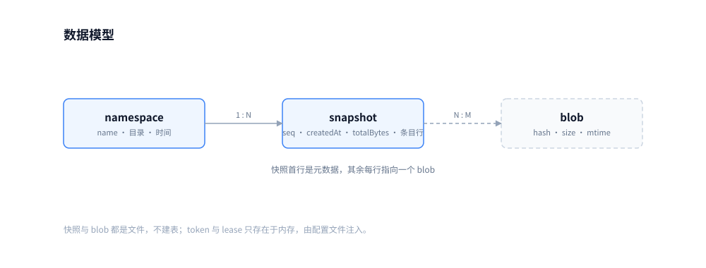

# sync-center 设计

通用同步中心，用于在多台设备之间同步文件树。服务端只负责保存不可变快照并按请求返回内容；同步策略、冲突取舍、删除保护全部由客户端脚本承担。

## 1. 范围

服务端提供：

- 内容寻址的 blob 存储，跨快照、跨 namespace 去重；
- 快照级版本控制，每次推送产生一个不可变快照；
- 每 namespace 严格串行的提交，通过租约实现；
- Bearer token 认证，token 决定 namespace 与读写权限。

持久化的只有 namespace 与 snapshot。blob 以文件形式存放，不单独建表；token 与租约只存在于内存。

服务端不提供：冲突合并、删除传播决策、WebDAV、多副本、端到端加密、细粒度权限。

## 2. 模型



- **namespace**：一组同步数据的边界，对应一个客户端配置的同步目标。
- **snapshot**：一次推送的完整状态，用一份 manifest 描述，创建后不可修改。
- **manifest**：快照的文件清单，记录 `path → blob` 映射，是快照内容的唯一来源。
- **blob**：按 sha256 寻址的文件内容，全局共享，不可变。
- **lease**：提交意图的互斥凭据，只存在于内存。

版本号使用每 namespace 自增的 `seq`，不使用时间戳。`seq` 同时是对外暴露的快照标识，表的主键只在内部使用。

### manifest

```json
{
  "files": [
    {"path": "notes/todo.md", "hash": "<hex64>", "size": 123, "mode": 420, "mtime": 1794419423123}
  ]
}
```

服务端在写入前按 `path` 的 UTF-8 字节序排序，并序列化为不含空白字符的 JSON。客户端无需保证顺序。`mode` 可省略，默认 0644。`mtime` 为文件的 Unix 毫秒时间戳，由客户端提供，服务端只保存和返回，用于客户端的冲突处理。

## 3. 存储布局

```
data/
  blobs/
  namespaces/
    default/
      00000022.jsonl
      00000023.jsonl
  tmp/
```

每个快照一个 JSONL 文件，首行是元数据，其余每行一个文件条目。文件名只承载 `seq`，元数据只存在于文件里；head 是目录中 `seq` 最大的那个文件，不需要额外的指针文件。

按行组织而不是把整个 manifest 存成单个 JSON 文档：读取、提交比对、垃圾回收都按行流式进行，服务端不必把 manifest 读进内存，`head -1` 也能直接看到元数据。

blob 以流式方式写入临时位置，内容哈希与长度校验通过后原子移入正式位置；校验失败时丢弃临时内容。blob 的元数据由文件系统提供。

写入与改名之后都执行 `fsync`（文件一次、目录一次），避免崩溃时留下“文件名存在但内容为空”的截断文件。

blob 不压缩。传输压缩由 HTTP 层处理。

## 4. 快照文件

```
{"seq":22,"createdAt":1762870000,"totalBytes":55445562}
{"path":"notes/todo.md","hash":"<hex64>","size":123,"mode":420,"mtime":1794419423123}
```

首行是 `seq`、`createdAt`（Unix 秒）与 `totalBytes`（各条目 `size` 之和）。之后每行一个条目，字段与 API 中的 manifest 条目一致，顺序固定，条目按 `path` 的 UTF-8 字节序排序。

文件名是 `%08d.jsonl`，补零只为目录整齐，排序仍按数值解析。读取首行后与文件名中的 `seq` 比对，不一致视为损坏。

提交先写 `tmp/` 下的临时文件，再原子改名到 `namespaces/<ns>/`，两次都做 `fsync`；崩溃留下的临时文件由垃圾回收清理。

无法解析的快照文件会被列表跳过并记录警告；如果损坏的是 seq 最大的那个，`latest` 与 `metadata` 返回 500 而不是回退到旧版本，避免客户端把旧状态当成最新。提交仍可继续，新版本会覆盖同 seq 的损坏文件。

`path` 按 UTF-8 字节序比较。写入前校验：非空、相对路径、以 `/` 分隔、无 `.`/`..`/空段、无反斜杠、长度 ≤ 1024、非控制字符。

## 5. 租约与提交

租约只保护提交，不保护 blob 上传。blob 是内容寻址且幂等的，允许任意客户端并发写入；两个客户端上传同一内容最终落在同一个文件。

租约保存于内存，按 namespace 建立索引，进程重启后全部失效。

生命周期：

1. 客户端 `POST /v1/lease`。本 namespace 已有未过期租约时返回 423，这就是占用信号。
2. 租约 TTL 由 `LEASE_TTL` 配置，默认 60 秒，覆盖一次提交的传输与写入。客户端在长传输中可以调用 heartbeat 续期，每次续到当前时间 + TTL。
3. 客户端上传所需 blob（与租约无关）。
4. 客户端 `POST /v1/snapshots`，携带 `leaseId`。服务端校验后写入快照文件，成功后删除租约；`parent` 不匹配返回 409 时同样删除租约，客户端重新拉取后可以直接重试。
5. 客户端异常退出时，租约在 TTL 后自然失效；也可主动 `DELETE /v1/lease/{id}` 提前释放。

提交时的检查，全部失败即拒绝：

|检查|失败码|
|---|---|
|租约存在、属于本 namespace、未过期|423|
|`parent` 等于当前 head 的 `seq`（首次推送为 null）|409|
|manifest 中每个 `hash` 对应的 blob 都存在且大小一致|422|
|manifest 与 head 不同|不报错，返回 head 原样|

规范化后的 manifest 与 head 相同时不创建新快照，直接返回当前 head，避免客户端无意义重推刷掉版本历史。

## 6. HTTP API

`/v1` 下的接口要求 `Authorization: Bearer <token>`。`GET` 与 `HEAD` 接口对 `r` 和 `rw` 都可用，其余接口要求 `rw`。错误响应为 `{"error":"<code>","message":"<text>"}`。

监听端口上的 `/livez`、`/readyz` 不要求 namespace token，供编排系统探测；`/ui` 与 `/ui/api/*` 使用面板会话，与 namespace token 无关，见第 9 节。

请求体与响应体的字段统一使用 camelCase。

用户可见文案支持简体中文与英文。错误码保持英文，`message` 按 `Accept-Language` 本地化；响应头带 `Content-Language` 与 `Vary: Accept-Language`。服务端只维护 `error.*` 文案，界面文案全部由前端词典提供，键缺失时原样显示键名。

### 租约

|方法|路径|说明|
|---|---|---|
|POST|`/v1/lease`|201 `{leaseId, expiresAt}`；已占用 423|
|POST|`/v1/lease/{id}/heartbeat`|200 `{expiresAt}`|
|DELETE|`/v1/lease/{id}`|204|

### blob

|方法|路径|说明|
|---|---|---|
|PUT|`/v1/blobs/{hash}`|body 为原始字节；204；内容哈希不符 422|
|HEAD|`/v1/blobs/{hash}`|已存在 204，不存在 404|
|GET|`/v1/blobs/{hash}`|200 二进制，带 `Content-Length`；不存在 404|

请求体按流式处理，不缓冲到内存。`Content-Length` 必须与实际字节数一致，单文件上限默认 256 MiB，超限返回 413。blob 已存在时直接返回 204，不重复落盘。

`GET /v1/blobs` 不支持 Range，客户端整文件下载。

### 快照

|方法|路径|说明|
|---|---|---|
|POST|`/v1/snapshots`|body `{leaseId, parent, manifest}`；201 `{seq}`|
|GET|`/v1/snapshots/latest`|200 完整快照|
|GET|`/v1/snapshots/{seq}`|200 完整快照|
|GET|`/v1/snapshots?limit=10`|200 快照元数据列表，不含 manifest|

回滚不需要专用接口：取历史快照的 manifest，以当前 head 为 `parent` 重新提交即可产生一个新快照。

提交请求体上限 64 MiB，超限返回 413；这是传输上限，与 manifest 的 10 万条目上限相互独立。

### 运维

|方法|路径|说明|
|---|---|---|
|GET|`/livez`|进程存活即 200，不记录访问日志|
|GET|`/readyz`|数据目录可读写返回 200，否则 503；`READYZ_TOKEN` 非空时要求 `?token=`|
|GET|`/auth`|单页应用的登录视图，不需要会话|
|POST|`/api/auth`|body `{token}`；成功 200 并下发 30 天会话 cookie，失败 401；登录并发独立配额 2，排队超过 10 秒返回 503|
|GET|`/ui`|只读浏览页面，需要会话，未登录跳转 `/auth`|
|GET|`/ui/api/*`|页面使用的只读接口，需要会话|
|POST|`/v1/gc`|用 rw token 触发一次回收；200 `{removed, durationMs}`，回收进行中 423|

### 元信息

|方法|路径|说明|
|---|---|---|
|GET|`/v1/metadata`|200 当前 token 所属 namespace、权限模式与最近 5 条快照摘要|

```json
{
  "namespace": "default",
  "mode": "rw",
  "snapshots": [
    {"seq": 21, "createdAt": 1762870000, "totalBytes": 812345}
  ]
}
```

客户端启动时可先调用它确认 namespace 与权限，不必先探测 blob 或快照。快照列表按 `seq` 倒序，最多 5 条，不含 manifest。

面板接口里的 namespace `createdAt` 是现存最老快照的时间，`updatedAt` 是最近一次快照的时间；裁剪会让 `createdAt` 前移，这两项只用于展示。

完整快照响应：

```json
{
  "seq": 17,
  "createdAt": 1762870000,
  "totalBytes": 812345,
  "manifest": {
    "files": [
      {"path": "notes/todo.md", "hash": "<hex64>", "size": 123, "mode": 420, "mtime": 1794419423123}
    ]
  }
}
```

状态码：

|码|含义|
|---|---|
|401|token 缺失或无效|
|403|token 权限不足|
|404|资源不存在|
|409|`parent` 与 head 不匹配|
|422|请求体不合法、manifest 引用缺失 blob、blob 校验失败|
|423|namespace 已有活跃租约|
|503|并发配额排队超时|

## 7. 版本保留

每个 namespace 保留最近的 10 个快照。裁剪在提交时完成。

## 8. 垃圾回收

服务按 `GC_INTERVAL` 定时回收（默认 86400 秒，0 表示不自动回收），启动后先跑一次。也可以用 `POST /v1/gc` 手动触发；回收正在进行时再触发返回 423。处理两类对象：不再被任何存活快照引用的 blob，以及未完成的临时写入。

候选来自 `blobs/` 目录中的文件，与各 namespace 存活快照的 manifest 汇总出的引用集合求差。清理持写锁，请求持读锁，因此清理期间租约、快照、元信息与面板接口会排队等待，通常只有毫秒级。blob 传输与登录不参与：前者耗时长且不受影响（已打开的文件 unlink 后仍可读完），后者恒定耗时 1 秒。

提交与清理在进程内由同一把锁互斥；外部 `gc` 子命令用于停服维护，与提交通过 `DATA_DIR/.lock` 的 `flock` 互斥。

任何快照文件无法解析时回收直接失败，不删除任何 blob：读不出引用的快照不能被当成“没人引用”。数据目录里存在 `sync.db`（旧布局或 Python 原型）时同样拒绝运行，避免删掉对侧仍在引用的 blob。

临时写入超过保留时间后直接丢弃。

## 9. 认证

- token 只存在于内存，服务端启动时从配置文件加载。
- 客户端在 `Authorization: Bearer` 中携带明文 token。
- 服务端计算 `sha256(token)` 后在内存映射中查找所属 namespace 与权限，找不到即 401，权限不足即 403。
- 日志与错误信息中不出现明文 token。访问日志不记录 `Authorization` 头。
- 同一 namespace 可配置多个 token，用于设备轮换与撤销；增删 token 需要重启服务。
- 应用层不做全局限流，由前置反向代理负责；登录有独立的并发配额，见下。

面板与会话：

- `AUTH_TOKEN` 是面板访问口令，启动时用 Argon2id（m=19456, t=2, p=1）折叠成 PHC 字符串，运行期只保留哈希。
- 登录并发配额为 2，与 `/v1` 的配额互相独立；Argon2 每次约占 19 MiB 内存，恒定耗时 1 秒的等待在释放配额之后进行，登录失败不会拖住其他请求。
- 登录成功签发无状态会话：`<base64url(exp|nonce)>.<base64url(HMAC-SHA256(key, "v1|" + payload))>`，`key` 为 `SESSION_SIGNING_KEY`，有效期 30 天。
- 会话以 `session` cookie（HttpOnly、SameSite=Lax）下发，同时接受 `Authorization: Bearer <会话>`，便于脚本调用。
- 校验先验签名再验过期；登录成功与失败都至少耗时 1 秒，避免用响应时间区分口令。
- 会话是无状态的，无法单个吊销；轮换 `SESSION_SIGNING_KEY` 会让所有会话失效。

## 10. 配置

监听地址与数据目录通过环境变量提供，namespace 与 token 通过配置文件提供。

|变量|默认值|说明|
|---|---|---|
|HOST|127.0.0.1|监听地址|
|PORT|8080|监听端口|
|DATA_DIR|/data|数据目录|
|CONFIG_FILE|${DATA_DIR}/config.yaml|配置文件路径|
|READYZ_TOKEN|空|非空时 `/readyz` 要求 `?token=` 等于该值|
|AUTH_TOKEN|无默认值|面板访问口令，16-128 位字母、数字、下划线；不配置拒绝启动|
|SESSION_SIGNING_KEY|无默认值|会话签名密钥，32-128 位字母、数字、下划线；不配置拒绝启动|
|TRUSTED_PROXIES|127.0.0.1/32,::1/128|逗号分隔的 CIDR；只有直连对端落在其中才采信 `X-Forwarded-For` 与 `X-Real-IP`|
|MAX_API_CONCURRENCY|128|`/v1` 与 `/ui/api` 的并发上限|
|MAX_STATIC_CONCURRENCY|64|页面与静态资源的并发上限|
|LEASE_TTL|60|租约有效期，单位秒，1-86400|
|GC_INTERVAL|86400|自动回收间隔，单位秒，0-604800；0 表示不自动回收，只响应 `POST /v1/gc`|

配置文件为 YAML：

```yaml
namespaces:
  - name: "default"
    tokens:
      - "REPLACE_WITH_RANDOM_TOKEN1:rw"
      - "REPLACE_WITH_RANDOM_TOKEN2:r"
```

- `tokens` 每项为 `<token>:<权限>`，权限取 `r` 或 `rw`，作用于整个 namespace。
- token 主体为 16-128 位字母、数字或下划线，与面板口令同一套字符集。
- namespace 名称为 1-63 位字母、数字或横线；它会成为数据目录下的子目录名，不含其他字符。
- namespace 名称在启动时对应数据目录下的一个子目录，不存在则创建。
- 加载后只保留 token 的哈希与权限，明文不落盘。
- 配置文件包含明文 token，应限制为 0600 权限。
- 启动时校验格式，不合法直接拒绝启动；修改配置后需要重启服务。

## 11. 客户端约定

服务端不强制以下行为，但客户端脚本按此实现。

同步根由客户端配置，服务端不解释路径语义，按字符串原样保存和返回。客户端可以只同步其中一部分路径，提交的 manifest 也只包含这部分；这类过滤是客户端行为，使用不同过滤规则的客户端必须各用独立 namespace，否则一方推送会把另一方范围内的路径视为删除。

状态文件 `.sync-center.json`：

```json
{
  "snapshot_seq": 17,
  "files": {"notes/todo.md": {"hash": "...", "size": 123, "mtime": 1794419423123}}
}
```

push：

1. 扫描本地，计算每个文件的 sha256 和 mtime（Unix 毫秒）。
2. 与 state 对比，找出新增和变更的文件。
3. 对每个新 blob，`HEAD /v1/blobs/{hash}` 确认不存在后 `PUT` 上传。
4. `POST /v1/lease`。返回 423 时间隔重试几次，或直接退出并提示用户稍后重试。
5. `POST /v1/snapshots`，`parent` 为 state 中的 `snapshot_seq`，manifest 中每个文件带上 `mtime`。
6. 成功后更新 state。

manifest 由本地完整扫描生成，因此未出现在 manifest 中的路径即视为删除，服务端不需要额外的删除接口。

pull：

1. `GET /v1/snapshots/latest`。
2. 对 manifest 中的每个文件，比较本地 mtime 与条目中的 `mtime`：
   - 本地较大：保留本地版本，不下载；
   - 否则：下载 blob，覆盖本地，并把本地文件的 mtime 回写为条目中的值。
   下载先落到根目录下的 `.sync-staging/`，全部成功后再逐个原位替换，中途失败不会留下半套文件。
3. 本地存在但远端没有的路径默认保留；带 `--delete` 时先移入 `.sync-trash/<snapshot_seq>/` 再删除，保留期由脚本决定。
4. 更新 state。

冲突处理采用 last-write-wins，以文件 mtime 为准。前提是各设备时钟保持同步，时钟偏差会让较快的设备持续胜出。

脚本单次运行内串行处理，不并发操作同一 namespace。

## 12. 部署

- 单个静态二进制（`CGO_ENABLED=0`），运行时只依赖数据目录。
- 监听地址与数据目录通过环境变量提供，namespace 与 token 通过配置文件提供。
- 数据目录包含 `blobs/`、`namespaces/`、`tmp/` 与 `.lock`，必须位于本地文件系统，不能放在 NFS 或网络卷上。启动时会把数据目录权限收紧为 0700。
- 监听地址取自 `HOST` 与 `PORT`，对外通过反向代理或 WireGuard 地址暴露。
- 备份方式为停止写入后复制整个数据目录。

## 13. 非目标

- 不做 WebDAV 兼容层。
- 不做服务端冲突合并或三方 diff。
- 不做多副本、故障转移、水平扩展。
- 不做端到端加密，传输安全依赖 WireGuard 或 TLS。
- 不做路径级 ACL，token 权限只有只读与读写两档，作用于整个 namespace。
- 不做 blob 存储压缩。
- 不做断点续传；`GET /v1/blobs` 不承诺 Range 支持。

## 14. 未决

- 单个 namespace 的配额上限，以及超限时的错误码。