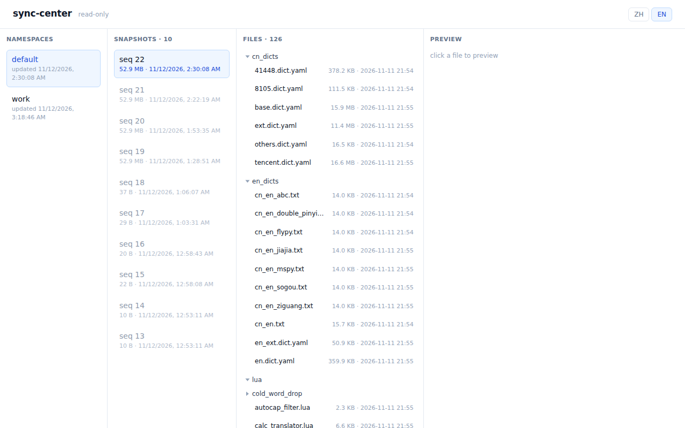

# sync-center

通用同步中心：服务端只保存不可变快照，冲突取舍与删除保护由客户端负责。完整设计见 [DESIGN.md](DESIGN.md)。

Go 实现，产物是单个静态二进制。HTTP 协议与 `../sync-center` 的 Python 原型一致；存储布局不同（Go 用 `namespaces/<ns>/*.jsonl`，Python 用 `sync.db`），两者不能指向同一份数据目录，混用会让垃圾回收删掉对侧仍在引用的 blob。



## 构建

```bash
just build        # 构建前端，交叉编译 amd64 + arm64 到 .dist/
just check        # go vet + go test + 前端类型检查
```

二进制用 `CGO_ENABLED=0` 构建，`ldd` 显示 `not a dynamic executable`。

## 运行

```bash
mkdir -p .data
cp config.example.yaml .data/config.yaml   # 修改里面的 token
DATA_DIR=$PWD/.data PORT=18080 ./.dist/app-linux-amd64
```

启动前必须设置两个变量，否则拒绝启动：

```bash
AUTH_TOKEN=<面板口令> SESSION_SIGNING_KEY=<32 位以上随机串>
```

访问 `/admin` 会跳转到 `/auth`，输入口令后建立 30 天会话。页面与错误消息支持中英文，由 `Accept-Language` 和浏览器的 `localStorage.lang` 决定。`/livez`、`/readyz` 供编排系统探测，`/readyz` 在 `READYZ_TOKEN` 非空时要求 `?token=`。

## 前端

面板是 Vue 3 + Vite + TypeScript，源码在 `frontend/`，产物落到 `frontend/dist` 并被 `go:embed` 编进二进制。

`/auth` 与 `/admin` 返回同一份入口，登录后原地切换到面板视图，不刷新页面。语言切换在右上角，词典在 `src/i18n.ts`，用 `satisfies Record<string, Entry>` 约束，漏键或漏某一种语言都会让 `pnpm typecheck` 失败。

## 配置

环境变量与 `config.yaml` 的语义见 DESIGN.md 第 10 节。配置里每个 token 形如 `"<token>:rw"` 或 `"<token>:r"`，决定 namespace 与读写权限。

token 主体为 16-128 位字母、数字或下划线，namespace 名称为 1-63 位字母、数字或横线；不满足时启动直接失败，不会带着宽松的配置跑起来。

## 测试

服务启动后执行：

```bash
python3 ../sync-center/tests/smoke.py   # 默认连 127.0.0.1:18080
```

测试假设配置使用 `sync_default_rw_2026a:rw`、`sync_default_ro_2026a:r`（namespace `default`）与 `sync_work_rw_2026a:rw`（namespace `work`）。

## 客户端

客户端模板在 `../sync-center/scripts/sync-center.ps1`，两个实现共用同一份协议，直接指向本服务的地址即可。

## 垃圾回收

服务按 `GC_INTERVAL`（默认 86400 秒）自动回收，启动后先跑一次；设成 0 就只保留手动触发。清理期间请求会短暂排队，通常只有毫秒级。删除不再被任何存活快照引用、且超过一小时没有变动的 blob，以及残留的临时文件。

回收跨 namespace，无法用 namespace token 授权，因此手动触发只认 `GC_TOKEN`。设了它才会开放接口，留空时该路径不存在：

```bash
curl -X POST http://127.0.0.1:8080/admin/api/gc \
  -H "Authorization: Bearer $GC_TOKEN"
# {"removed":3,"durationMs":12}
```

回收正在进行时再调会返回 423，不会排队。停服维护时仍可用子命令，只需要 `DATA_DIR`：

```bash
DATA_DIR=$PWD/.data ./.dist/app-linux-amd64 gc
```

## 性能

本机 loopback + SSD，与 `../sync-center` 的 Python 原型跑同一套基准：

| 项目 | Python 原型 | Go |
| --- | --- | --- |
| 单请求延迟（metadata） | 2.6 ms | 0.4 ms |
| 4 KiB blob 串行上传 | 811 个/s | 2658 个/s |
| 50 MiB 上传 | 373 MiB/s | 560 MiB/s |
| 50 MiB 下载 | 245 MiB/s | 577 MiB/s |
| 4×50 MiB 并发下载 | 265 MiB/s | 804 MiB/s |
| 提交 1 万条 manifest | 0.10 s | 0.05 s |
| 提交 5 万条 manifest | 0.45 s | 0.22 s |

真实部署的瓶颈是网络带宽与客户端的哈希扫描，不是服务端。

内存：空载约 28 MB；单个快照的读取几乎不增加 RSS（逐行流式），8 个并发读取 14.6 MB 快照峰值约 59 MB、结束后回落到 16 MB；提交 10 万条 manifest 峰值约 85 MB。一千个文件的提交约 12 ms。

## 限制

- 单进程运行，租约保存在内存，重启后全部失效；
- 单个 blob 上限 256 MiB，单个 manifest 上限 10 万条；
- 没有 TLS 与限流，对外部署需要前置反向代理；
- 面板会话无状态，轮换 `SESSION_SIGNING_KEY` 会让所有人重新登录。
